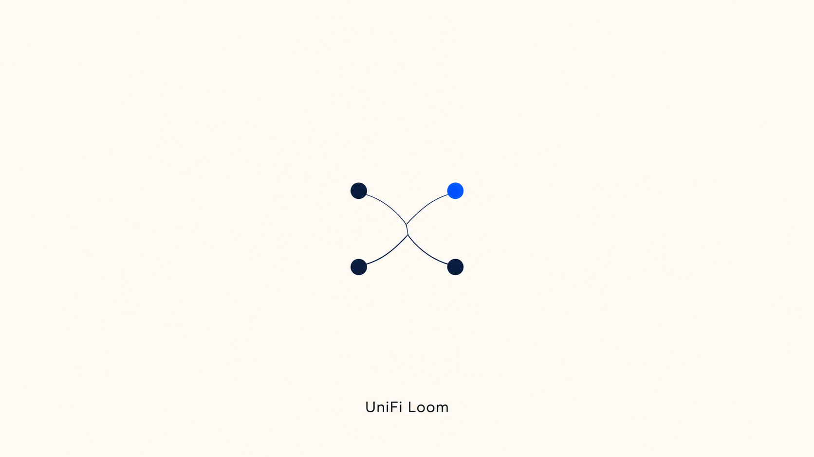
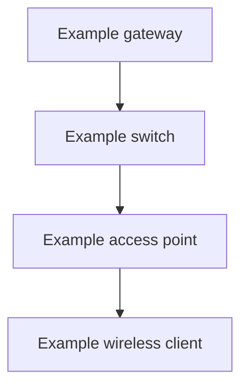

<p align="center"></p>

# UniFi Loom

**A local UniFi Network MCP server for AI-assisted network administration and Mermaid topology diagrams.**


Connect an MCP-compatible AI assistant to a UniFi Dream Machine Pro or compatible UniFi Network console. Inspect clients and access points, manage VLANs, Wi-Fi and firewall policies, adjust AP radios, and generate physical or logical network diagrams.

## What it does

- Exposes all **73 operations** in the bundled official Network **10.6.106** specification, with request/schema validation.
- Adds direct tools for common network queries, with a [task-to-tool guide](docs/TOOLS.md).
- Supports AP channel selection, channel width, transmit-power presets/custom dBm and minimum RSSI through an opt-in internal adapter.
- Generates **Mermaid** physical topology and logical VLAN/subnet diagrams from reported relationships.
- Previews every mutation, requests human approval, rejects stale state, submits once, and retains inspectable outcomes.
- Runs locally over **stdio**, with verified HTTPS, scoped certificate trust, and credentials kept in a local `.env`.

**Compatibility:** live read-only checks have passed on UniFi OS 5.1.33 / Network 10.6.106. Writes and complete Network UI parity are not hardware-verified. Internal endpoints are version-dependent. WAN/VPN configuration, durable backups, automatic rollback and binary/file endpoints remain outside the implemented surface. See [validation](VALIDATION.md).

## Quick start

Requires Python 3.11+ and [uv](https://docs.astral.sh/uv/). Run on a machine with LAN or VPN access to the console.

```sh
git clone https://github.com/sohanmanju/unifi-loom.git
cd unifi-loom
uv sync --extra test
cp .env.example .env
```

Edit `.env` locally:

```dotenv
UNIFI_URL=https://192.168.1.1
UNIFI_API_KEY=YOUR_LOCAL_NETWORK_INTEGRATION_KEY
UNIFI_ALLOW_WRITES=false
```

Create the integration key in your console's **Network → Integrations** settings. Some layouts use **Settings → Control Plane → Integrations**. Keep credentials out of chat, Git, screenshots and support reports.

For a self-signed console certificate, set `UNIFI_CA_CERT` to a locally verified PEM certificate/CA. If connecting by IP while the certificate names a DNS host, set `UNIFI_TLS_SERVER_NAME` to that certificate name as well. Chain, expiry and hostname verification remain enabled. Only this process trusts the supplied certificate; system trust is unchanged.

Launch:

```sh
uv run --env-file .env unifi-loom
```

This process waits for MCP messages on stdin. It does not start a web dashboard or HTTP listener. Usually the MCP host starts it automatically.

## Connect your AI client

For hosts supporting `mcpServers` JSON, replace every placeholder with an absolute path:

```json
{
  "mcpServers": {
    "unifi-loom": {
      "command": "/absolute/path/to/uv",
      "args": [
        "run", "--directory", "/absolute/path/to/unifi-loom",
        "--env-file", "/absolute/path/to/unifi-loom/.env",
        "unifi-loom"
      ]
    }
  }
}
```

For Codex:

```sh
codex mcp add unifi-loom -- uv run \
  --directory /absolute/path/to/unifi-loom \
  --env-file /absolute/path/to/unifi-loom/.env unifi-loom
codex mcp list
```

Restart/reload the host after registration. Try: **“List my UniFi clients and access points, then generate a physical network diagram.”** Consult [Codex's MCP documentation](https://learn.chatgpt.com/docs/extend/mcp?surface=cli) for host configuration.

## Use the right tool

Start with the task-specific tools in [docs/TOOLS.md](docs/TOOLS.md). They avoid the discovery/describe/request sequence for common reads. The generic `list_operations`, `describe_operation` and `read_operation` tools remain available for the rest of the official API and custom internal routes.

Official operations use a **site UUID**, obtained from `list_sites`. Internal operations use a legacy site name such as `default`. AP radio tools use the legacy device `_id` and exact radio interface name from `get_ap_radios`.

For writes, set `UNIFI_ALLOW_WRITES=true` locally. The host must support **MCP form elicitation** and show the human approval prompt. A model-provided approval argument cannot bypass it. Unsupported hosts fail closed.

## AP radio controls

Enable `UNIFI_INTERNAL_ENABLED=true`. Use `UNIFI_INTERNAL_AUTH=api_key` if the console accepts integration keys on internal routes. This mode does not initiate an account/MFA login. Otherwise use `session` with a dedicated local account in `UNIFI_USERNAME` / `UNIFI_PASSWORD`; SSO/MFA challenges are not implemented.

Call `get_ap_radios`, then prepare an edit using an exact interface name:

```json
{
  "device_id": "LEGACY-AP-ID",
  "radio_name": "wifi1",
  "settings": {"channel": 44, "channel_width_mhz": 80, "power_mode": "medium"},
  "reason": "Apply the chosen radio configuration",
  "site": "default"
}
```

These values illustrate the shape of `prepare_ap_radio_change`, not recommended RF settings. It preserves every other radio and existing field. The preview is bound to the AP ID/radio table read from device inventory; unrelated live statistics do not invalidate it. Use `apply_change` to request approval and submit.

Channel and power support `auto`. Custom dBm must fall inside reported AP bounds. Wider channels require reported capability. Country-specific availability, DFS and effective RF behavior require controller validation and hardware testing. Provisioning can interrupt Wi-Fi clients.

## Mermaid diagrams



The example is synthetic. Live diagrams include only reported relationships and warn about unknown attachments. Logical VLAN groups do not imply routing connectivity or firewall permission. Canonical snapshots are validated before rendering; labels are escaped and generated node IDs prevent syntax injection. Set `save=true` on `generate_diagram` to export `.mmd` files into `UNIFI_STATE_DIR/diagrams`.

## Advanced API coverage

For unsupported UI features, verified internal Network routes can be added through an operator-owned manifest via `UNIFI_INTERNAL_MANIFEST`. See [internal API extensions](docs/INTERNAL_API.md). The model cannot register routes or supply arbitrary URLs. Protect, Access, console account administration, SSH and shell execution are not exposed.

## Mutation behavior

Plans are immutable, single-use and expire after ten minutes. Readable resources are checked again before submission; this is a client-side precondition, not a server transaction. Commands and creation may lack a comparable baseline. Writes are never automatically replayed after rejection, cancellation or timeout.

`change_status` distinguishes prepared, submitting, accepted, rejected and unknown outcomes. Accepted submissions remain accepted if audit persistence or read-back fails; these secondary failures are separate fields. A failed pre-submission audit blocks the write. Outcomes are retained in memory for one hour, capped at 256. Restarting clears pending plans and outcomes.

Audit records contain a request hash and operation metadata, not payloads. Known secret fields are redacted from responses; unexpected undocumented fields can still contain sensitive values. Runtime inventories, diagrams and certificates belong in private local storage. See [security guidance](SECURITY.md).

## Development

```sh
uv sync --extra test
uv run pytest -q
uv run python tests/stdio_smoke.py
uv build
```

CI tests Python 3.11, 3.12 and 3.13, runs a real offline MCP protocol smoke, scans tracked files and builds the wheel. Tests never require real network hardware or credentials. [CONTRIBUTING.md](CONTRIBUTING.md) describes the module boundaries and change requirements.

## Sources and license

Original project code is MIT-licensed. Vendor API definitions are separately attributed in [NOTICE.md](NOTICE.md). This is an independent project, not an official Ubiquiti product.

- [Official UniFi API overview](https://help.ui.com/hc/en-us/articles/30076656117655-Getting-Started-with-the-Official-UniFi-API)
- [Network 10.6.106 documentation](https://developer.ui.com/network/v10.6.106/gettingstarted)
- [Community node-unifiapi radio implementation](https://github.com/delian/node-unifiapi/blob/master/index.js)
- [Art of WiFi API client](https://github.com/Art-of-WiFi/UniFi-API-client)
- [Official MCP Python SDK](https://github.com/modelcontextprotocol/python-sdk/tree/v1.x)
